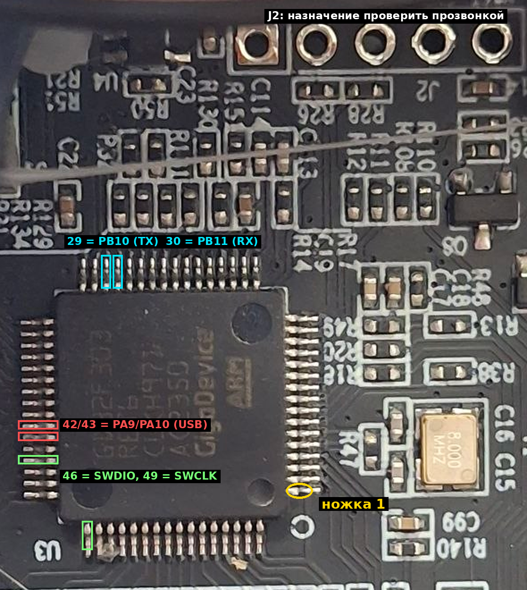

# Плата пользователя: CR4NS200320C13

По фото (13.11.2026):

- Плата **CR4NS200320C13** — ревизия **C13**, под неё и собирается наш Marlin (`marlin/c13`).
- МК **GD32F303RET6** (GigaDevice), корпус LQFP64.
- Кварц **8 МГц** — совпадает с настройкой сборки (72 МГц от 8 МГц).
- Незапаянные гребёнки: **J2** (5 контактов, над МК, первый контакт квадратный, рядом последовательные резисторы R26/R28) и **J6** (4 контакта, рядом с USB-C, со стрелкой у первого контакта).

## Ориентация МК

Ножка 1 — в углу с маленькой ямкой на корпусе, рядом кружок «O» на плате (на крупном фото это правый нижний угол). Это подтверждает и кварц: его ножки OSC_IN/OSC_OUT (5 и 6) должны быть рядом с ножкой 1, и кварц действительно стоит у правой стороны внизу. Дальше нумерация идёт против часовой стрелки:

| Сторона на крупном фото | Ножки | Нужные нам |
|---|---|---|
| правая, снизу вверх | 1–16 | 7 = NRST |
| верхняя, справа налево | 17–32 | **29 = PB10 (TX), 30 = PB11 (RX)** — 4-я и 3-я слева |
| левая, сверху вниз | 33–48 | 42 = PA9, 43 = PA10 (USB/CH340), 46 = PA13 (SWDIO) |
| нижняя, слева направо | 49–64 | 49 = PA14 (SWCLK) — крайняя слева |

## Что прозвонить

Принтер выключен и отключён от сети. Мультиметр в режиме прозвонки (пищалка). Щупом удобнее касаться не самой ножки МК, а её «колена» у платы; можно взять иглу на щуп.

**J2** — каждый из 5 контактов по очереди (1 = квадратный):

| Контакт J2 | Проверить с |
|---|---|
| 1…5 | ножка 29 (PB10), ножка 30 (PB11) |
| 1…5 | ножка 46 (SWDIO), ножка 49 (SWCLK), ножка 7 (NRST) |
| 1…5 | GND (минус любого разъёма, например концевика) |
| 1…5 | 3,3 В (плюс конденсатора у стабилизатора 3,3 В или ножка 32/48/64 МК) |

**J6** — каждый из 4 контактов:

| Контакт J6 | Проверить с |
|---|---|
| 1…4 | ножка 42 (PA9), ножка 43 (PA10) |
| 1…4 | GND, 5 В (контакт VBUS разъёма USB-C или 5 В на плате) |

**Если J2 не связан с PB10/PB11** — проследить, куда идут дорожки от ножек 29 и 30 (они уходят вверх, к блоку резисторов под J2), и прозвонить ножки 29/30 с площадками этих резисторов. К площадке резистора припаяться проще, чем к ножке МК.

Результат запиши в виде таблицы «контакт → ножка / GND / 3,3 В / 5 В / ничего» и пришли — по нему выберем точку подключения ESP. Если J2 окажется USART3 или SWD, это лучший вариант: ставим штыревую гребёнку 2,54 мм и подключаемся без пайки к ножкам МК.

## Гипотезы (не проверено)

- J2 с двумя последовательными резисторами — похоже на служебный разъём с двумя сигнальными линиями: SWD (SWDIO/SWCLK) или UART. Дорожки от ножек 29/30 (PB10/PB11) идут в сторону J2, так что вариант «J2 = USART3» возможен, но по фото это не доказать.
- J6 у USB-C — скорее всего USART1 (PA9/PA10) параллельно CH340, то есть тот же порт, что и USB. Для ESP он не подходит без развязки CH340, но удобен для проверки USB-TTL адаптером.
